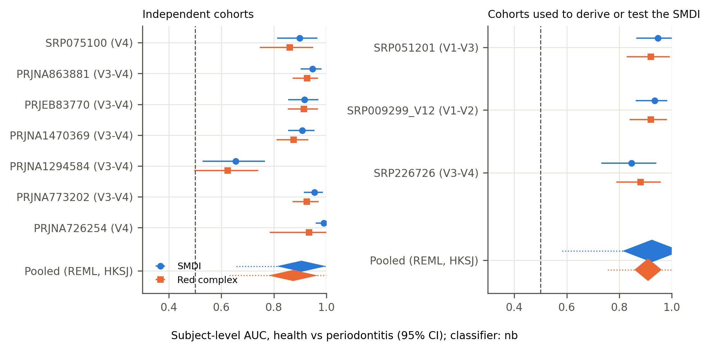

# Validation on public clinical and simulated data

This page reports the pre-specified multi-cohort validation described in
[ANALYSIS_PLAN.md](ANALYSIS_PLAN.md), a detailed case study on one of its
cohorts (SRP075100), a cross-check against the reference R
implementation of the SMDI, a simulation with known truth and a runtime
benchmark. Every number comes from one run of `validation/reproduce.sh`
on 21 November 2026; the generated report is
[`validation/results/REPORT.md`](../validation/results/REPORT.md) and the
tables are in [`validation/results/tables/`](../validation/results/tables/).

To reproduce everything from a fresh clone:

```bash
bash validation/reproduce.sh ~/q2-validation-data
```

It installs the environments, runs the tests, processes every cohort of
`validation/cohorts.tsv` and writes all tables, figures and `REPORT.md`.
The reported run took 12 hours on a 48-core Linux server and downloaded
about 47 GB of reads. See [validation/README.md](../validation/README.md)
for requirements and outputs.

## Multi-cohort validation

### Cohorts and processing

Sixteen cohorts (15 ENA accessions) were included by the documented
search in `validation/search/`. They fall into four groups, analysed
separately:

| Group | Cohorts | Used for |
|---|---|---|
| Independent case-control | SRP075100, PRJNA863881, PRJEB83770, PRJNA1470369, PRJNA1294584, PRJNA773202, PRJNA726254 | primary meta-analysis |
| Independent therapy | PRJNA786436, PRJNA736618, PRJEB106816 (and SRP075100, PRJNA726254) | change after therapy, prognosis |
| Region robustness | PRJNA773195 (same samples as PRJNA773202, V1–V3); SRP009299_V4 | region comparison only |
| Used to derive or test the SMDI | SRP051201, SRP009299_V12, SRP226726, SRP062274 | reported separately, never pooled with the independent cohorts |

Every cohort was processed with DADA2, except SRP009299 (Deblur; see
[Deviations](#deviations)), and classified with two classifiers trained
on eHOMD 16S RefSeq V15.23:
naive Bayes (primary) and VSEARCH. No sample was lost after denoising.
One reverse-read file (SRR20721137 of PRJNA863881) was an empty directory
on ENA and was taken from NCBI SRA; its forward reads were identical to
ENA's in all 610,040 sequences and quality strings
([provenance note](../validation/results/provenance/PRJNA863881_sra_fallback.md)).

None of the independent cohorts raised a pre-specified QC flag (median
depth 28,600–177,000 reads; 0.18–0.35 of reads in a complex). Four of the
derivation and test cohorts were flagged and, as the plan requires,
reported rather than excluded: SRP051201, SRP009299_V12 and SRP009299_V4
had a median depth below 5,000 reads, and SRP226726 had fewer than 10% of
reads assigned to a complex. The per-cohort QC table is
[`validation/results/qc.tsv`](../validation/results/qc.tsv).

### Q1. Health vs periodontitis

Subjects are the unit of analysis. AUC is P(periodontitis > health), with
95% CIs from a stratified bootstrap over subjects; pooling is by
random-effects meta-analysis (REML with Hartung–Knapp–Sidik–Jonkman CI).

| Cohort | Region | Health / periodontitis | SMDI | Red complex |
|---|---|---|---|---|
| SRP075100 | V4 | 21 / 48 | 0.90 (0.81–0.97) | 0.86 (0.75–0.95) |
| PRJNA863881 | V3–V4 | 23 / 81 | 0.95 (0.90–0.98) | 0.93 (0.87–0.97) |
| PRJEB83770 | V3–V4 | 41 / 47 | 0.92 (0.85–0.97) | 0.91 (0.85–0.97) |
| PRJNA1470369 | V3–V4 | 32 / 116 | 0.91 (0.85–0.95) | 0.87 (0.81–0.93) |
| PRJNA1294584 | V3–V4 | 30 / 70 | 0.65 (0.53–0.77) | 0.62 (0.50–0.74) |
| PRJNA773202 | V3–V4 | 53 / 65 | 0.95 (0.91–0.99) | 0.93 (0.87–0.97) |
| PRJNA726254 | V4 | 13 / 15 | 0.99 (0.96–1.00) | 0.93 (0.78–1.00) |
| **Pooled, independent (k = 7)** | | 213 / 442 | **0.90 (0.81–1.00)** | 0.87 (0.78–0.97) |
| Pooled, derivation/test (k = 3) | V1–V3, V1–V2, V3–V4 | 82 / 84 | 0.92 (0.81–1.04) | 0.91 (0.86–0.96) |

Pooled AUC over the seven independent cohorts (naive Bayes):

| Measure | Pooled AUC (95% CI) | 95% prediction interval | I² |
|---|---|---|---|
| **SMDI** | **0.90 (0.81–1.00)** | 0.66–1.15 | 83% |
| SMDI_simplified | 0.87 (0.76–0.98) | 0.58–1.16 | 82% |
| PC2014_moderate | 0.85 (0.74–0.96) | 0.56–1.14 | 83% |
| Red complex | 0.87 (0.78–0.97) | 0.63–1.12 | 77% |
| Orange complex | 0.70 (0.62–0.78) | 0.49–0.91 | 69% |
| Purple complex | 0.39 (0.28–0.51) | 0.09–0.69 | 74% |
| Green complex | 0.30 (0.17–0.43) | −0.04–0.64 | 84% |
| Yellow complex | 0.22 (0.13–0.31) | −0.01–0.44 | 71% |
| Blue complex | 0.20 (0.14–0.27) | 0.09–0.31 | 34% |

Prediction limits outside 0–1 come from the normal approximation on the
AUC scale. The complexes behave as the Socransky model predicts: Red and
Orange were higher in periodontitis and Yellow, Green and Blue lower in
all seven cohorts; Purple was lower in six.

**Heterogeneity comes mostly from one cohort.** In PRJNA1294584 every
measure discriminated poorly (SMDI 0.65), although its depth and
assignment were typical. Leaving it out gave a pooled SMDI AUC of 0.94
(0.91–0.98) with I² = 52%; leaving out any other cohort kept the estimate
at 0.89–0.90. The cause is not known. The DerSimonian–Laird estimate
(0.91, 0.87–0.96), bootstrap standard errors (0.91) and the VSEARCH
classifier (0.90, 0.81–0.99) gave the same answer.



### Q2. SMDI vs Red complex

In paired DeLong comparisons, the SMDI's AUC exceeded the Red complex's by
a pooled 0.023 (95% CI 0.010–0.037; p = 0.005; I² = 0%), and by 0.024
(0.012–0.035) with VSEARCH. No single cohort showed a significant
difference after Benjamini–Hochberg correction (smallest q = 0.50).
SMDI_simplified was no better than the Red complex (0.001, −0.018 to
0.019). The gain of the 49-species index over three species is consistent
but small.

### Q3. Published cut-offs

Pooled subject-level sensitivity and specificity in the seven independent
cohorts:

| Index > cut-off | Sensitivity (95% CI) | Specificity (95% CI) |
|---|---|---|
| SMDI > 0 | 0.89 (0.77–0.95) | 0.68 (0.58–0.76) |
| SMDI > 0.4 (best in training) | 0.86 (0.72–0.94) | 0.75 (0.67–0.82) |
| **SMDI > 0.5 (best in test)** | **0.85 (0.69–0.93)** | **0.79 (0.69–0.86)** |
| SMDI_simplified > 0 | 0.67 (0.43–0.84) | 0.85 (0.73–0.92) |

Sensitivity varied strongly between cohorts (I² = 85–89%): at 0.5 it
ranged from 0.44 (PRJNA1294584) to 1.00 (PRJNA726254).

### Q4. Change after non-surgical therapy

Change = follow-up − baseline, paired by subject or site; Wilcoxon
signed-rank test, Benjamini–Hochberg q.

| Cohort | Follow-up | Paired units | Median SMDI change | Units decreased | q |
|---|---|---|---|---|---|
| SRP075100 | after therapy | 19 sites | −0.25 | 13 / 19 | 0.18 |
| PRJNA726254 | after therapy | 15 subjects | −1.69 | 12 / 15 | 0.035 |
| PRJNA786436 | 3 months | 22 sites | −1.27 | 15 / 22 | 0.10 |
| PRJNA736618 | day 1 | 38 subjects | −2.38 | 30 / 38 | 2.2 × 10⁻⁵ |
| PRJNA736618 | day 7 | 38 subjects | −2.77 | 34 / 38 | 3.6 × 10⁻⁸ |
| PRJNA736618 | day 90 | 38 subjects | −3.05 | 31 / 38 | 1.1 × 10⁻⁵ |
| PRJEB106816 | follow-up 2, treated | 18 subjects | −0.35 | 11 / 18 | 0.15 |
| PRJEB106816 | follow-up 2, untreated | 17 subjects | +0.39 | 5 / 17 | 0.11 |

The median SMDI fell in all five independent therapy cohorts,
significantly in two. In the controlled trial PRJEB106816, the SMDI fell
in the treated arm and rose in the untreated arm (between-arm AUC 0.75,
p = 0.011), but this did not survive correction (q = 0.19). In SRP062274
(not independent), the SMDI fell in both arms, more with antibiotics at
3 months (AUC 0.71, p = 0.028, q = 0.25) but not at 6 or 12 months.

### Q5. Baseline values and non-response

Baseline SMDI did not predict non-response: AUC 0.50 (0.23–0.74) by site
in PRJNA786436 (11 vs 11 sites) and 0.40 (0.23–0.59) by subject in
SRP062274 (19 vs 18).

### Q6. Clinical measures

In PRJNA863881 (104 subjects), the SMDI correlated with probing depth
(Spearman ρ = 0.61), clinical attachment loss (0.60), bleeding on probing
(0.64), plaque index (0.42) and stage (0.58; all q < 10⁻⁴). It correlated
with stage in PRJNA1470369 (ρ = 0.52, 148 subjects) but only weakly in
PRJNA1294584 (0.22, q = 0.055). In PRJNA786436, whose 22 sites came from 5
subjects, there was no correlation with any site-level measure.

### Robustness

* **Classifier.** Naive Bayes and VSEARCH gave nearly the same SMDI in
  every cohort (Spearman ρ 0.98–0.99) and the same pooled AUC.
* **16S region.** The same 118 samples in V1–V3 (PRJNA773195) and V3–V4
  (PRJNA773202) discriminated equally (AUC 0.955 vs 0.954; ρ = 0.96), but
  V1–V3 values were 0.41 higher (p = 2 × 10⁻¹⁰). In SRP009299, V1–V2 and V4
  gave AUC 0.93 and 0.89 (ρ = 0.90).
* **Pseudocount.** Fixed pseudocounts of 10⁻⁶ to 10⁻⁴ left the median
  cohort AUC at 0.92–0.93 and the ranking nearly unchanged (ρ ≥ 0.96), but
  shifted the median SMDI by up to 1.1.
* **Rarefaction.** Rarefying to 1,000, 5,000 or 10,000 reads (10 draws)
  changed the cohort AUC by less than 0.06 on average, except where few
  samples reached the depth (SRP009299_V12 at 5,000 reads: −0.10).

The ranking of subjects is robust; absolute SMDI values, and therefore
cut-offs, depend on the region and the pseudocount.

### Deviations

Changes from [ANALYSIS_PLAN.md](ANALYSIS_PLAN.md) (version 1.0,
2026-10-22), each with its reason:

| Change | Reason | Effect on the pre-specified results |
|---|---|---|
| SRP009299 (V1–V2 and V4) denoised with Deblur instead of DADA2 | The SRA quality strings are constant (reads submitted without real base qualities), so DADA2 cannot learn an error model. Recorded in `validation/configs/SRP009299_V12.sh` before any index was computed. | Affects only these two derivation/region cohorts, which are never pooled with the independent cohorts. |
| One file of PRJNA863881 (SRR20721137, reverse reads) taken from NCBI SRA instead of ENA | ENA served an empty directory in place of the file on 2026-11-21. The SRA forward reads were identical to ENA's. | None expected: same reads; one of 124 subjects. |
| Synthetic performance benchmark (2026-11-03), simulation with known truth (2026-11-04), cross-check and benchmark against R microbiome 1.6.0 (2026-11-21) added | Software validation requested for publication. | None: additional analyses, not part of Q1–Q6. |
| `run_analysis.py` skips, with a warning, a therapy follow-up whose time label is missing (2026-11-21) | One missing label would otherwise stop the analysis of every cohort. | None: no follow-up was skipped in the reported run. |

The PRJNA773195 fallback written in its configuration (forward reads only
if DADA2 kept less than 10% of reads) was not triggered: DADA2 kept a
median of 32%.

## Case study: SRP075100

This section gives more detail on one independent cohort. The values come
from the original single-cohort run (legacy files at the top of
`validation/results/`); the final multi-cohort pipeline reproduced its
AUCs and cut-off results to two decimals.

### Dataset

Chen et al. (2018, *ISME J* 12:1210–1224), SRA **SRP075100**. The data are
Illumina MiSeq reads of the 16S rRNA V4 region (515F/806R) from
subgingival plaque collected with paper points at two contralateral
maxillary posterior teeth per subject:

| Group | Samples | Subjects |
|---|---|---|
| Healthy (HP) | 42 | 21 |
| Periodontitis, before therapy (D1P) | 96 | 48 |
| Periodontitis, ≥ 4 weeks after non-surgical therapy (D2P) | 19 | 19 |

Groups, subjects and teeth are taken from the SRA sample titles
(`GROUP_SUBJECT_TOOTH…`). Clinical scores per sample are not in the SRA
records, so the analysis uses the diagnostic groups.

The dataset is **independent of the SMDI's derivation**. Chen, Marsh &
Al-Hebshi (2022) trained it on Abusleme 2013, Griffen 2012 and Kirst 2015,
and tested it on Pei 2020, Bizzarro 2016 and HMP.

### Processing

QIIME 2 amplicon 2024.10. The reads are already merged and primer-free
(about 253 nt). DADA2 `denoise-single` (`--p-trunc-len 250`) was used. A
naive Bayes classifier was trained on eHOMD 16S RefSeq V15.23 trimmed to
515F/806R. `collapse-complexes` ran with default parameters.

### Quality control

| Measure (157 samples) | Median | IQR |
|---|---|---|
| Reads per sample | 28,600 | 24,000–33,900 |
| Reads in a Socransky complex | 0.29 | 0.20–0.40 |
| Reads named to species | 0.83 | 0.75–0.89 |

Most reads are named to species, but the Socransky panel covers only
about 30% of the community. Species resolution in V4 is uneven across
genera:

| Genus | Reads named to species |
|---|---|
| *Campylobacter*, *Porphyromonas*, *Prevotella* | ≥ 0.94 |
| *Treponema*, *Veillonella*, *Capnocytophaga*, *Fusobacterium* | 0.76–0.87 |
| ***Streptococcus***, ***Actinomyces***, *Fretibacterium* | **0.27–0.29** |

The *Streptococcus* species of the **Yellow complex (mitis/oralis/sanguinis
group) are largely unresolvable in V4**, so the Yellow complex is
underestimated here (median 0 in periodontitis subjects). The Blue group is
less affected, because it is assigned at genus level: all of its features
here were assigned through the *Actinomyces* genus entry. This is a
property of the amplicon, not of the plugin. Prefer longer or more
variable regions (e.g. V1–V3) when the early-colonizer complexes matter.

### Health vs periodontitis

Subjects are the unit of analysis: the two sites of each subject are
averaged. The 95% CI comes from a stratified bootstrap over subjects
(2000 resamples). AUC is P(periodontitis > health); values below 0.5 mean
higher in health.

| Measure | Median health | Median periodontitis | AUC (95% CI) | Mann-Whitney p |
|---|---|---|---|---|
| **SMDI** (49 species) | −0.07 | 2.43 | **0.90** (0.81–0.97) | 1.6 × 10⁻⁷ |
| SMDI_simplified | −3.68 | 1.26 | 0.86 (0.76–0.95) | 1.8 × 10⁻⁶ |
| PC2014_moderate | 0.015 | 0.095 | 0.84 (0.71–0.94) | 1.1 × 10⁻⁵ |
| Red complex | 0.002 | 0.099 | 0.86 (0.75–0.95) | 2.3 × 10⁻⁶ |
| Orange complex | 0.121 | 0.162 | 0.71 (0.56–0.84) | 0.0065 |
| Yellow complex | 0.003 | 0 | 0.18 (0.08–0.31) | 1.7 × 10⁻⁵ |
| Green complex | 0.008 | 0.005 | 0.38 (0.25–0.52) | 0.13 |
| Purple complex | 0.012 | 0.002 | 0.21 (0.09–0.35) | 1.5 × 10⁻⁴ |
| Blue (*Actinomyces*) | 0.047 | 0.009 | 0.16 (0.07–0.25) | 6.6 × 10⁻⁶ |

The complexes behave as the Socransky model predicts. The late
colonizers (Red, Orange) are higher in periodontitis. The early colonizers
(Yellow, Purple, Blue) are lower. Green is lower too, but not
significantly.

The full SMDI reproduces its published accuracy here: Chen et al. (2022)
reported AUC 0.92 in their test sets, against 0.90. Its published
cut-offs give:

| Cut-off | Unit | Sensitivity | Specificity | Accuracy |
|---|---|---|---|---|
| 0 | subjects | 0.90 | 0.52 | 0.78 |
| 0.4 (best in training) | subjects | 0.88 | 0.76 | 0.84 |
| **0.5 (best in test)** | **subjects** | **0.85** | **0.90** | **0.87** |
| 0.5 | samples | 0.79 | 0.74 | 0.78 |

The cut-off that maximizes Youden's J in this dataset is 0.54, close to
the published 0.5. Across all independent cohorts the same cut-off was
less specific (pooled 0.79; see Q3).

For SMDI_simplified at its published cut-off of 0: subjects 0.60 / 0.90 /
0.70 (sensitivity / specificity / accuracy), samples 0.62 / 0.88 / 0.70.
That is specific but less sensitive. This is consistent with the authors'
note that V4 data place the SMDI about one unit lower than V1–V3. The
in-sample Youden cut-off is −1.46 (0.85 / 0.81). It was chosen on the
same data, so it is descriptive only.

**16 of the 49 SMDI species are absent from this V4 table**, including the
top health-associated *S. sanguinis*, *A. naeslundii* and *S. mitis*, and
*Fretibacterium* HMT 359/360/362. The reason is the poor species
resolution of these genera in V4 (see Quality control). Absent taxa enter
at the pseudocount, as the method prescribes. The plugin lists the absent
taxa in a warning.

**The indices largely agree.** Spearman ρ, n = 69 subjects: SMDI vs
SMDI_simplified 0.91, SMDI vs PC2014_moderate 0.73.

### Response to non-surgical therapy

Same tooth before (D1P) and after (D2P) therapy, one site per subject, n =
19. Change = after − before.

| Index | Median change | Sites that decreased | Wilcoxon signed-rank p |
|---|---|---|---|
| SMDI | −0.25 | 13/19 | 0.096 |
| SMDI_simplified | −0.57 | 12/19 | 0.29 |
| PC2014_moderate | −0.019 | 13/19 | 0.13 |

All indices tend to decrease after therapy, but no change is significant
with 19 sites. The original study also described heterogeneous site-level
responses. Larger therapy cohorts are in Q4.

## Cross-check against R microbiome 1.6.0

`validation/analysis/rcheck.py` computes the SMDI and SMDI_simplified with
`validation/analysis/smdi_microbiome.R`, which calls
`microbiome::transform(x, "clr")` of microbiome 1.6.0 (R 3.6.3, phyloseq
1.28.0, from `validation/r-microbiome-1.6.0.yml`), and compares it with
the plugin sample by sample. A table passes when every sample differs by
less than 10⁻⁹ and undefined values match.

**All 74 tables passed**: both indices for every processed cohort with
both classifiers (64 tables), 6 simulated and 4 synthetic tables. The
largest absolute difference was 3.6 × 10⁻¹⁵, and no undefined value
differed. The table is
[`r_crosscheck.tsv`](../validation/results/tables/r_crosscheck.tsv).

The same script times the 49-species SMDI in both implementations on the
synthetic tables of the performance benchmark, counting only the
computation from loaded counts to the index. R was faster at every size
above 100 features: 0.05 s against 0.66 s for the plugin at 25,000
features and 500 samples. Both are well under a second. The plugin used
less memory at every size: its whole process peaked at 157–202 MB, against
385–695 MB for R, whose dense count matrix grows with the table
([`r_benchmark.tsv`](../validation/results/tables/r_benchmark.tsv),
`fig7_r_benchmark`). Each process reports its own peak RSS (VmHWM), so the
parent's memory is not counted.

## Performance

`validation/analysis/performance.py` measures `collapse-complexes` on
synthetic sparse feature tables (5% density, fixed seed). Each
configuration is run three times in an isolated process; the table reports
the median runtime and the maximum peak RSS. Runtime grows linearly with
the number of features; the number of samples has little effect up to
500.

| Features | Samples | Nonzeros | Runtime (s) | Peak RSS (MB) |
|---|---|---|---|---|
| 1,000 | 10 | 484 | 0.133 | 158.0 |
| 1,000 | 500 | 24,450 | 0.137 | 159.4 |
| 10,000 | 10 | 4,894 | 1.005 | 169.9 |
| 10,000 | 500 | 243,891 | 1.016 | 173.7 |
| 25,000 | 10 | 12,178 | 2.497 | 190.5 |
| 25,000 | 500 | 609,640 | 2.489 | 201.7 |

The full table is in
[`validation/results/tables/performance.tsv`](../validation/results/tables/performance.tsv)
and the figure is `fig5_performance`. The run used the supported
environment (Python 3.10.14, NumPy 1.26.4, pandas 2.2.2, SciPy 1.13.0,
BIOM 2.1.15) on a 48-core Linux server with 503 GB RAM;
[`performance_environment.json`](../validation/results/performance_environment.json)
records it. These are synthetic engineering measurements, not biological
results.

## Simulated communities

`validation/analysis/simulation.py` generates 100 synthetic communities
(50 health, 50 periodontitis) from 71 reference and SMDI taxa with known
complex fractions and SMDI values (fixed seed 20261104). It compares the
plugin output with the latent truth at 1,000, 5,000 and 20,000 reads. The
stress scenario masks 20% of the assigned taxa (about 9% of reads) as
unclassified.

| Scenario | Depth | Unassigned reads | Complex MAE | SMDI MAE | SMDI Pearson | SMDI Spearman | Assignment accuracy |
|---|---|---|---|---|---|---|---|
| clean | 1k | 0 | 0.015 | 0.528 | 0.989 | 0.911 | 0.968 |
| unassigned | 1k | 0.090 | 0.022 | 0.554 | 0.988 | 0.910 | 0.878 |
| clean | 5k | 0 | 0.011 | 0.087 | 0.998 | 0.977 | 0.968 |
| unassigned | 5k | 0.090 | 0.020 | 0.494 | 0.998 | 0.975 | 0.878 |
| clean | 20k | 0 | 0.010 | 0.025 | 1.000 | 0.995 | 0.968 |
| unassigned | 20k | 0.090 | 0.019 | 0.514 | 1.000 | 0.990 | 0.878 |

With correct taxonomy, complex fractions and SMDI are recovered almost
exactly. At 1k reads, the SMDI MAE rises to about 0.5 and the Spearman
correlation falls to 0.91 because many species are absent and enter the
CLR at the pseudocount. Masking 20% of assigned taxa leaves SMDI Pearson
correlation near 1.0, but raises its MAE to about 0.5 and lowers
assignment accuracy to about 0.88. This is a
software and assignment test, not a biological validation; the figure is
`fig6_simulation` and the table is
[`validation/results/tables/simulation.tsv`](../validation/results/tables/simulation.tsv).

## Conclusions and limits

* **The 49-species SMDI is the best-performing and best-supported index.**
  In seven independent cohorts it reached a pooled AUC of 0.90
  (0.81–1.00), and it is numerically identical to the R implementation
  that defined it. Use it as the primary measure.
* Its advantage over the Red complex is consistent but small (0.023 AUC).
  SMDI_simplified (0.87) and PC2014_moderate (0.85) discriminate less
  well; SMDI_simplified needs only genus names, which makes it the
  fallback when species resolution is poor.
* The SMDI ranks subjects robustly across classifiers, regions,
  pseudocounts and depths, but its absolute values shift with the 16S
  region and the pseudocount. The published cut-off of 0.5 gave a pooled
  sensitivity of 0.85 and specificity of 0.79, with large differences
  between cohorts. Re-estimate cut-offs for each region and population.
* The SMDI fell after non-surgical therapy in every independent therapy
  cohort, but baseline values did not predict non-response.
* Heterogeneity was high (I² = 83%), mostly from one cohort
  (PRJNA1294584) whose low accuracy is unexplained. The prediction
  interval (0.66 to above 1) is the realistic range for a new population.
* The early-colonizer complexes and several SMDI species depend on
  species resolution, which short amplicons do not provide for oral
  streptococci and *Actinomyces*. Always report the `qc_*` columns and the
  SMDI absent-taxa warning.
* The indices summarize microbial composition. They are not diagnostic
  tests.
